# Songstress

> A self-hosted music suite: an Apple-Music-grade player for **web, desktop, and mobile (iOS & Android)** on top of your Navidrome library — with automated in-place FLAC upgrades, cross-library deduplication, playlist import, and cross-device playback.

[](https://github.com/pacholoamit/songstress-releases/issues)
[](https://github.com/pacholoamit/songstress-releases/releases/latest)
[](#clients)
[](LICENSE)

> [!WARNING]
> **Songstress is in ALPHA.** Expect rough edges, breaking changes between
> releases, and bugs. Please don't point it at irreplaceable data without
> backups. Hit something broken or have an idea? **[Open an issue](https://github.com/pacholoamit/songstress-releases/issues)** — feedback is very welcome and genuinely shapes what gets fixed next.

This repo hosts **releases, desktop installers, and the auto-update feed**. The source code lives in a private repository.

<p align="center">
  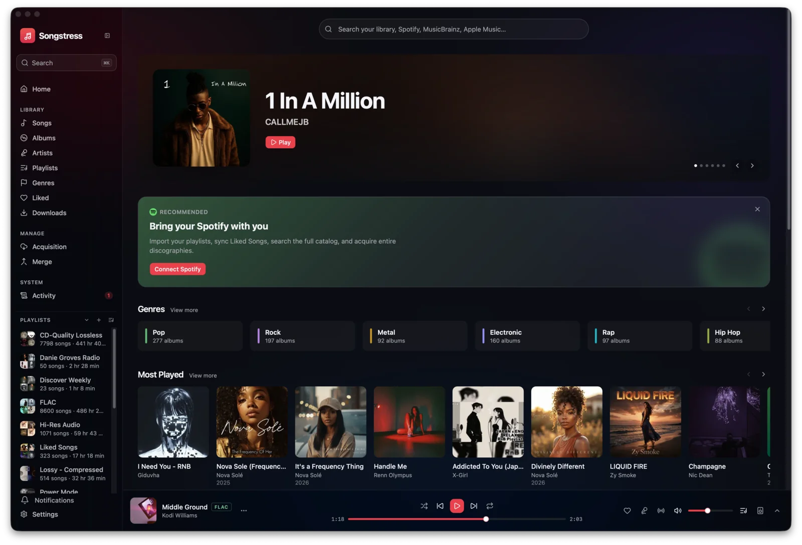
</p>

Songstress started as an answer to one itch — the MP3s and AACs that should have
been FLAC all along. **Acquisition** scans your library for lossy files, hunts
down verified-lossless replacements (12 lossless stores → Soulseek →
YouTube Music), and swaps them in place — and the same pipeline downloads whole artists,
albums, and playlists on demand — while your Navidrome favorites and playlists
stay intact.

It has since grown into the whole listening stack: a liquid-glass player that
follows you from the desktop to the couch to the phone, playlists imported from
Spotify and ListenBrainz, duplicate-free multi-library management, and Home
Screen widgets.

## Clients

One shared core, three first-class clients — a browser dashboard served straight
from the server, a desktop app, and a mobile app for iOS and Android.

| | Client | Highlights |
|---|---|---|
| 🌐 | **Web** | The full dashboard at `:8090`. Gapless dual-buffer playback, artwork-tinted pages, global search across your library, Spotify, MusicBrainz, and Apple Music. |
| 🖥️ | **Desktop** (macOS · Linux · Windows) | Tauri shell with a tray mini-player, native media keys + now-playing widget, offline downloads, close-to-tray, **auto-updates served from this repo**. |
| 📱 | **Mobile** (iOS · Android) | One Expo/React Native app: native tabs, a full-screen player with drag-to-dismiss, offline downloads, lock-screen / media-notification controls. **iOS adds Home Screen widgets and liquid-glass UI.** |

<details>
<summary><b>📱 The mobile app in pictures</b></summary>
<br/>

**Home** — shelves for Most Played, Newly Added, Recently Played

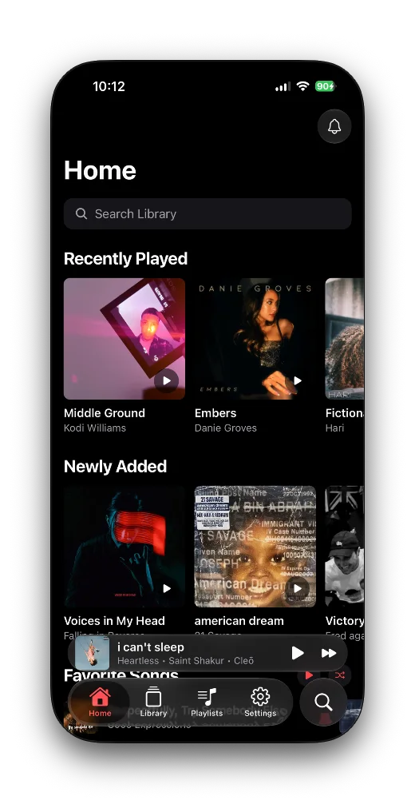

**Library** — songs, albums, artists, genres, liked

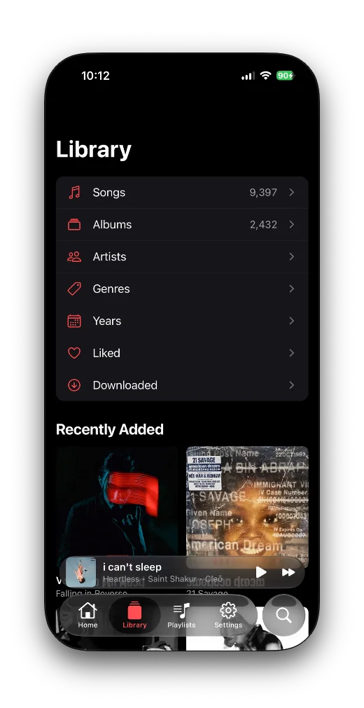

**Full-screen player** — liquid glass, drag-to-dismiss

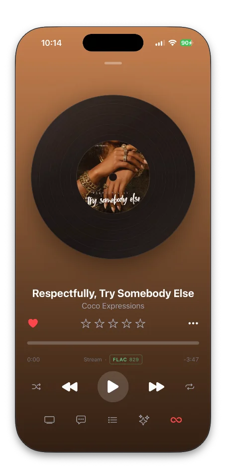

</details>

### Cross-device playback (Songstress Connect)

Every client registers as a device. Start music on the desktop, open the phone,
and the phone **auto-follows** the active session — remote transport controls,
live queue sync, and a one-tap handoff of playback between devices,
Spotify-Connect style.

<details>
<summary><b>📸 Remote-controlling another device from the phone</b></summary>
<br/>

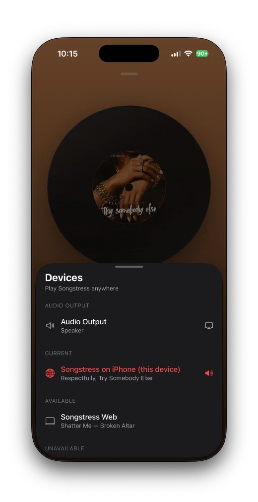

</details>

## Features

### Player & library

- Gapless playback with buffering-aware scrubbing on every platform, plus a
  **smart queue** — shuffle (current track pinned), repeat off / all / one,
  play-next & enqueue, drag-to-reorder, and a persisted queue that resumes right
  where you left off
- A **full-screen player** with Up Next / Lyrics / Related tabs, format badges
  (FLAC 16/44.1, MP3 320…), a Last.fm global play-count pill, and an optional
  **spinning vinyl** now-playing mode
- **Synced lyrics** — time-synced, tap any line to seek; plus an optional
  rolling lyric strip above the player bar
- Artwork-derived background washes on album/artist/playlist pages
- **Auto DJ & radio** — Track Radio and artist radio via Navidrome instant mix;
  Auto DJ keeps similar tracks flowing when the queue runs dry
- Browse **by genre and by year**, plus a Home full of shelves — Most Played,
  Newly Added, Recently Played, Recently Released, Explore From Your Library
- **Unified search** across your library, Spotify, MusicBrainz, and Apple Music
- A 10-band **equalizer with AutoEq headphone corrections** (search your exact
  headphones, one tap to apply)
- **Per-device player customization** and per-network stream quality (original,
  or Navidrome-transcoded MP3/Opus at a capped bitrate)
- Offline downloads on desktop and mobile

<details>
<summary><b>📸 The player, lyrics, library, and radio</b></summary>
<br/>

**Full-screen player** — artwork-tinted, Up Next / Lyrics / Related tabs

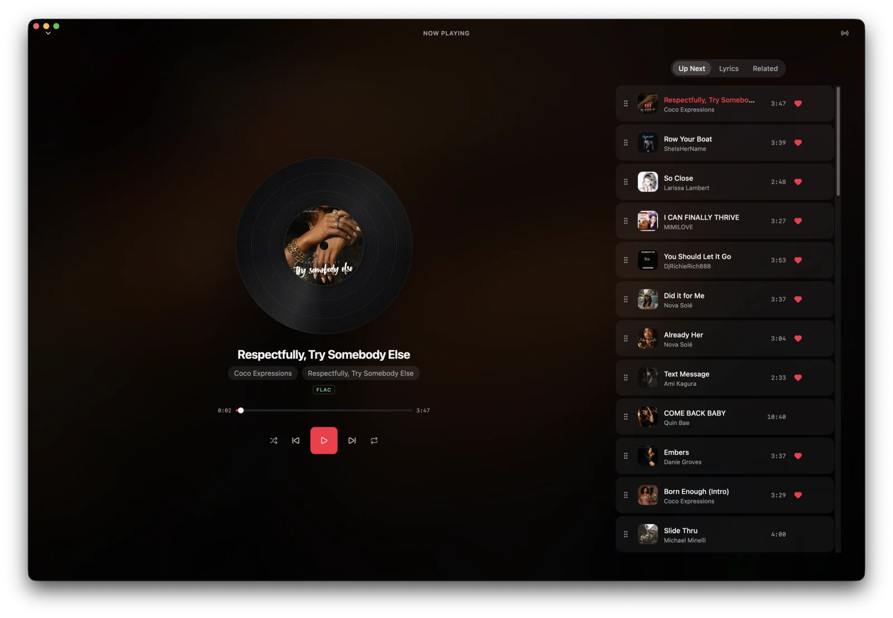

**Synced lyrics** — tap any line to seek

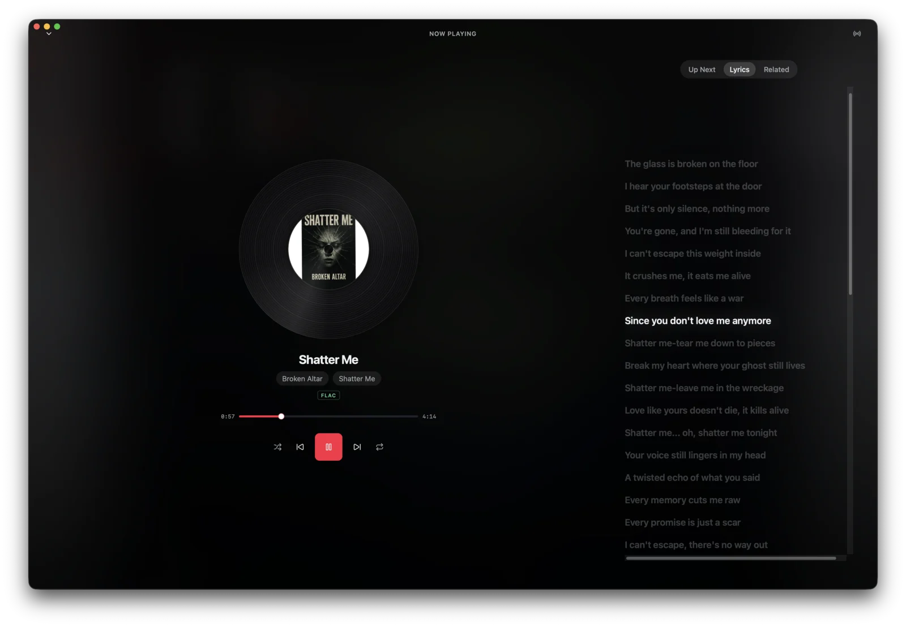

**Songs** — the library with format badges and play counts

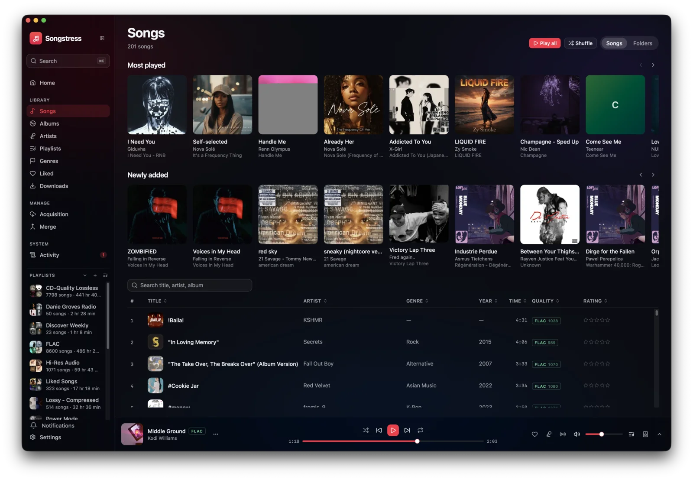

**Track radio on mobile** — instant mix seeded from any song

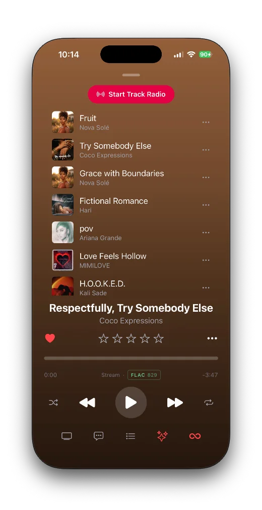

</details>

### Manage › Acquisition — the original heart of the project

- In-place lossy → FLAC upgrades with a strict duration-match guard
- Download whole artists, albums, and playlists on demand ("Add to Library"),
  filed into your library through the same verified-lossless pipeline
- A live dashboard: what passed / failed / is queued per service, scheduled
  sweep progress, worker concurrency, VPN rotation
- **12 lossless stores** — Tidal/Qobuz (Hi-Res), Deezer/Amazon/NetEase/
  JOOX/Migu/Kuwo (FLAC), Apple (ALAC), plus SoundCloud/YouTube/Pandora (lossy) —
  each toggled, drag-to-reorder
- **Quality ladder** (Atmos → Hi-Res Lossless → Hi-Res → Lossless → High → Low) and
  format gating (FLAC / ALAC / AAC / MP3); upgrades always stay lossless
- **Synced-lyrics embedding** (Spotify / Apple / Musixmatch / LRCLIB / Amazon) and
  **metadata enrichment** (Deezer / Apple / Qobuz / Tidal / SoundCloud)
- Folder + filename templates with download placeholders — preset or custom
- Two-tier retry back-off; one flat priority ladder (lossless stores / Soulseek /
  YouTube Music, YouTube limited to below-bitrate upgrades only); Navidrome rescan after
  swaps with favorites/playlist preservation

<details>
<summary><b>📸 The Acquisition dashboard and the upgrade feed</b></summary>
<br/>

**Acquisition dashboard** — lossless coverage, live jobs, per-service stats

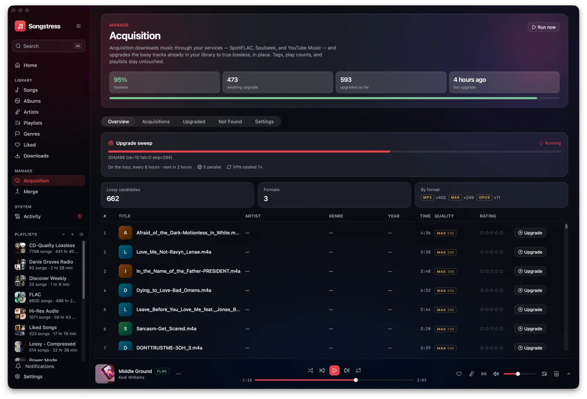

**Upgrade feed** — every lossy → FLAC swap, before → after

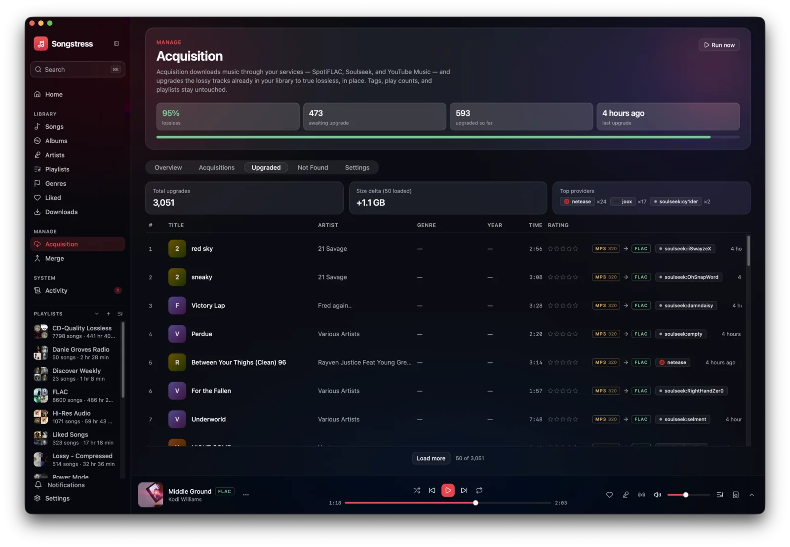

</details>

### Manage › Merge — duplicate-free multi-library

- Finds the same recording across libraries (MusicBrainz ID / ISRC exact
  matches, conservative metadata+duration matching below that)
- Keeps the highest-quality copy and replaces the rest with relative symlinks;
  quarantine + one-click **Undo** for every merge

<details>
<summary><b>📸 Merge review</b></summary>
<br/>

**Merge** — duplicate groups, confidence tiers, reclaimable space

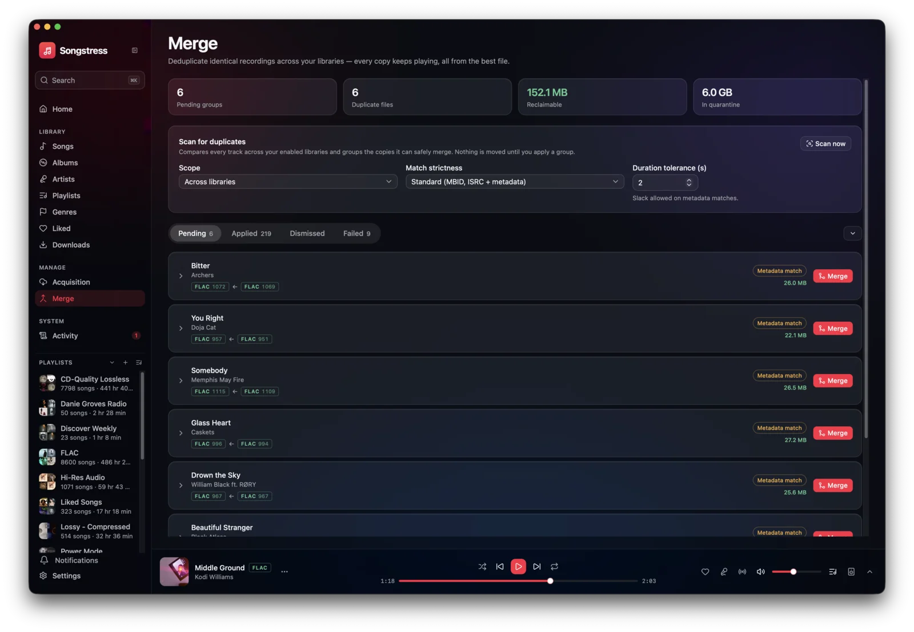

</details>

### Import & discovery

- Spotify, Apple Music, and Tidal playlist import (Tidal covers albums and
  discographies), Liked Songs sync, discography downloads, full-catalog search
- ListenBrainz "Made For You" weekly playlists; Last.fm & ListenBrainz scrobbling
- **Playlist time machine** — version history on a horizontal timeline; diff any
  two states, play or restore an old version
- **Drag-to-reorder playlists** on every client, written back to Navidrome

<details>
<summary><b>📸 Importing and living with playlists</b></summary>
<br/>

**Playlist import** — paste a Spotify / Apple Music / Tidal / ListenBrainz URL,
missing tracks are acquired losslessly and filed into your library

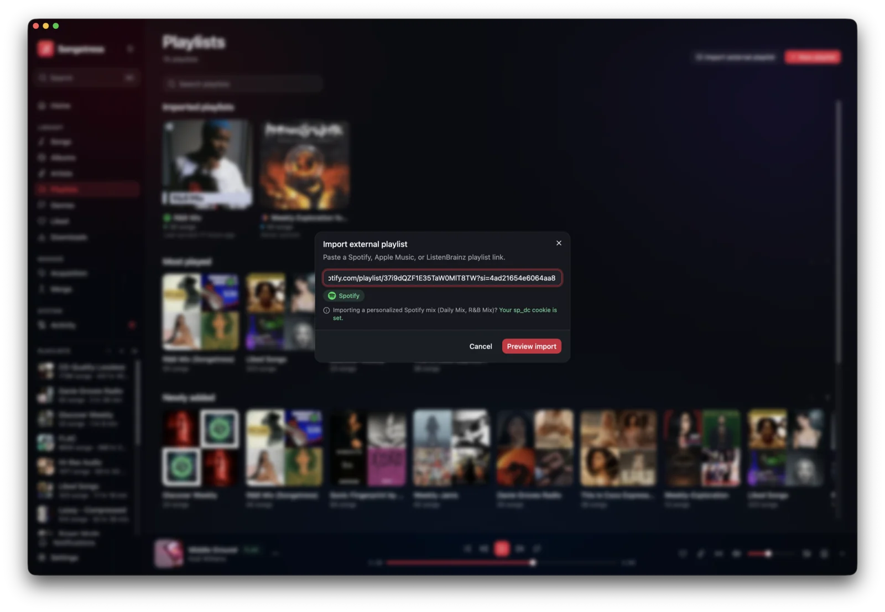

**Playlists** on desktop

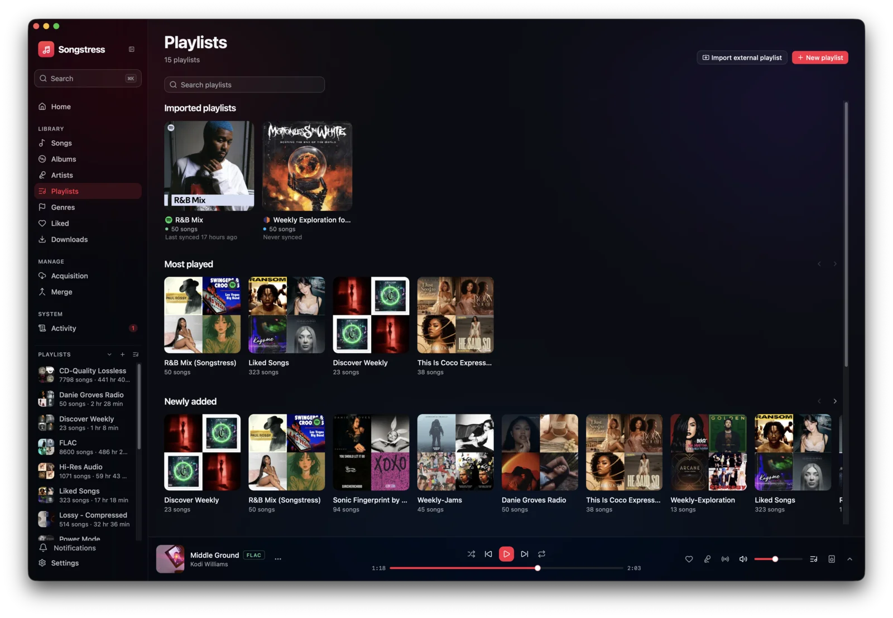

**A playlist page** — artwork-tinted, with the version-history time machine

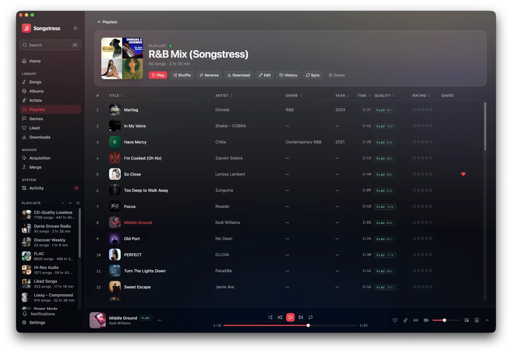

**Playlists on mobile** — browsing and inside a playlist

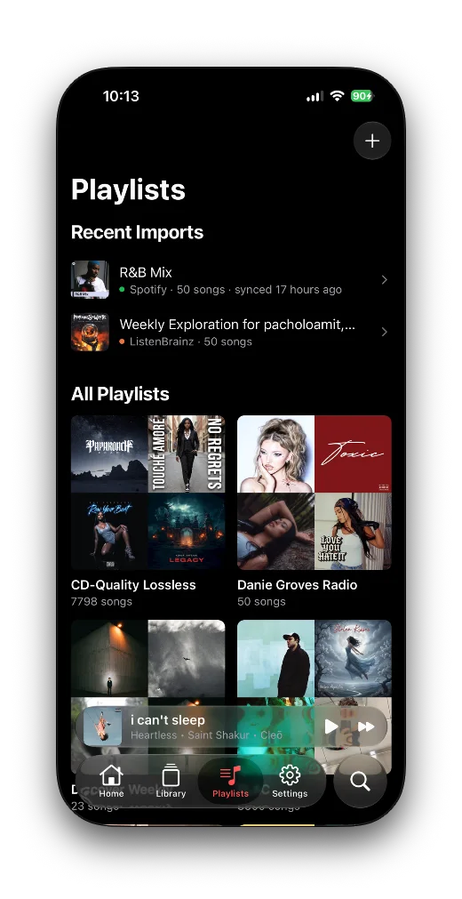

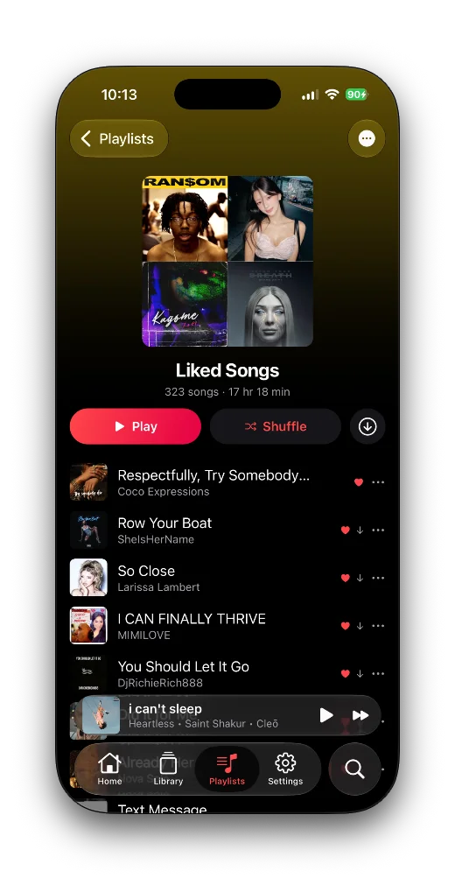

</details>

## Start Songstress

**You need:** a 64-bit Linux or macOS machine (amd64 or arm64; on Windows, use
WSL2) with [Docker](https://docs.docker.com/engine/install/) and its compose
plugin (`docker compose`), or Docker Desktop, and a few GB free for the images.
Discovery's sonic analysis wants about 8 GB of memory while it works. On
Docker Desktop that means the memory you give Docker under Settings →
Resources, not the machine's. On TrueNAS SCALE, run it as root and keep the
install on a pool dataset (for example `--install-dir /mnt/tank/apps/songstress`):
TrueNAS doesn't keep the boot drive's files across system updates.

```sh
curl -fsSL https://raw.githubusercontent.com/pacholoamit/songstress-releases/main/install.sh | sh
```

That's it. The line installs the `songstress` CLI (into `~/.local/bin`, or
`/usr/local/bin`) and starts its setup wizard, which:

1. asks where the install lives (`~/songstress` by default) and where your
   music is;
2. checks Docker, your ports and memory, and asks what you want: Discovery
   sonic analysis, VPN egress, your own Navidrome or a bundled one, your admin
   email;
3. generates compose files pinned to tested image versions, with generated
   secrets kept in a `.env` only you can read;
4. pulls the images and brings the stack up. It reports success only when the
   server answers, its worker has reported in, and Songstress has signed in to
   Navidrome, not merely when a container started.

The last screen lists the address to open (on this machine and from your other
devices) and your admin email. The generated password is
`SONGSTRESS_ADMIN_PASSWORD` in the install's `.env`:

```sh
grep SONGSTRESS_ADMIN_PASSWORD= ~/songstress/.env
```

Sign in with that pair on the web, desktop or mobile app. Point the desktop and
mobile apps at the same address.

Scriptable too:

```sh
songstress install --yes --music-dir /srv/music --components discovery
# already run Navidrome? use it (an admin account — checked before anything is written)
songstress install --yes --music-dir /srv/music \
  --navidrome-url http://192.168.1.10:4533 --navidrome-username you
  # password: --navidrome-password, or SONGSTRESS_NAVIDROME_PASSWORD in the environment
```

`songstress install --help` lists every flag. A taken port is caught before
anything is written: pick another with `--port`, or `--navidrome-port` for
the bundled Navidrome's.

**Re-running is safe.** Run `songstress install` again to change an answer:
your data, the admin sign-in and every generated password are kept (Navidrome
applies its admin password only on its first start, so the installer never
changes it), the earlier answers are the defaults, and settings you added to
the generated `.env` yourself are written back as you left them. A re-run says
which files it rewrites.

**Updating.** Each CLI release pins the Songstress release it was tested with
(`songstress --version` names both), so to update, run the install line again.
It fetches the newest CLI, then re-runs the setup with your answers as the
defaults. To update without the wizard:

```sh
curl -fsSL https://raw.githubusercontent.com/pacholoamit/songstress-releases/main/install.sh | sh -s -- --yes
# add --install-dir /path/to/install if it isn't ~/songstress
```

A re-run never moves an install to an older release. To install a particular
CLI release, set `SONGSTRESS_CLI_VERSION=cli-vX.Y.Z` for the install line.

**Stopping or removing it.** The compose project is named after the install
directory, so `docker compose -p songstress down` stops the stack and removes
its containers (add `-v` to delete Discovery's database volumes too). Your data
stays in `~/songstress/data`, next to the generated files: delete the
directory to remove it, then delete the `songstress` CLI.

**Nothing here asks you to trust an opaque binary.** The CLI's full source
lives in [`cli/`](cli/) in this repository, releases are built by [a public
workflow](.github/workflows/cli.yml) with `CGO_ENABLED=0 -trimpath` (build it
yourself and compare), every download is sha256-verified by
[`install.sh`](install.sh), and the generated compose files are plain YAML you
can read before ever running `docker compose up`.

### Networking is up to you

The installer publishes the dashboard on its port (`8090` by default), and the
bundled Navidrome on `4533` for other Subsonic apps, and stops there — it
terminates no TLS, claims no domain, and joins no tailnet. How those ports are
reached is yours to decide:

- **On your LAN** — nothing to do. Open `http://<host>:8090`.
- **From anywhere** — front it with whatever you already run: a reverse proxy
  (Caddy, nginx, Traefik), a Cloudflare Tunnel, Tailscale, a WireGuard VPN.

Point the proxy or tunnel straight at Songstress's port, and keep its route in
the proxy's own config. A route that lives on the Songstress container — Docker
labels read by caddy-docker-proxy or Traefik, say — disappears every time an
update recreates the container, and for that minute some proxies answer with a
permanent redirect that phones and browsers keep: their requests then loop on
it long after Songstress is back.

Bringing your own means you keep your certificates, your auth layer, and your
DNS — and Songstress never fights them for port 443. See
[Security](#security) before you expose it: what Songstress's sign-in covers,
and what it doesn't.

If you serve it on a public domain, re-run the installer with
`--public-url https://music.example.com` (or set `SONGSTRESS_PUBLIC_URL` in the
generated `.env` — a re-run keeps it) so invite and password-reset links in
emails point at your domain instead of `http://localhost:8090`.

**Navidrome's port** is for other Subsonic apps that use your library. From
v0.32 Songstress itself doesn't need it: it serves every stream and image
through its own port. `--publish-navidrome=false` (or "no" in the wizard) keeps
the bundled Navidrome off the host, and a re-run keeps whichever you chose. A
v0.31 server streams through Navidrome's port, so for one it stays published. To use
another host port, pass `--navidrome-port` (or set `NAVIDROME_PORT` in `.env`);
a re-run keeps it.

> Egress VPN is a different thing and still built in: `--components vpn` routes
> **acquisition traffic out** through [gluetun](#vpn-egress-gluetun). That's
> download privacy, not inbound access.

## Quickstart

Two containers, zero Navidrome configuration: the Songstress image (datastore,
web dashboard, acquisition worker) plus the official Navidrome alongside it.
Songstress provisions Navidrome, logs in, and triggers scans — you never
configure or even see it.

```sh
mkdir songstress && cd songstress
```

Create a `.env`:

```sh
# required
MUSIC_DIR=/path/to/your/music
# Navidrome creates its 'admin' with this on its FIRST start (a brand-new
# data/navidrome) and Songstress signs in with it — keep it once set.
NAVIDROME_PASSWORD=any-strong-value

# recommended
TZ=UTC

# accounts — invite-only (see "Accounts & invites"). Set this pair to pick your
# operator sign-in; leave empty to create the admin in-app on first connect.
SONGSTRESS_ADMIN_EMAIL=
SONGSTRESS_ADMIN_PASSWORD=

# email/SMTP — outbound invitations, password resets & notifications (optional)
SMTP_HOST=
SMTP_PORT=587
SMTP_USERNAME=
SMTP_PASSWORD=
SMTP_FROM=
SMTP_TO=
SMTP_STARTTLS=true

# optional integrations (editable later in the dashboard)
SPOTIFY_CLIENT_ID=
SPOTIFY_CLIENT_SECRET=
SPOTIFY_REDIRECT_URI=
LASTFM_API_KEY=
LISTENBRAINZ_TOKEN=
```

Create a `compose.yaml`:

```yaml
services:
  songstress:
    image: ghcr.io/pacholoamit/songstress:v0.37.0
    container_name: songstress
    env_file: .env
    environment:
      - PUID=1000
      - PGID=1000
      # Songstress provisions + drives the Navidrome service below, and serves
      # every stream and cover itself.
      - SONGSTRESS_MANAGED_NAVIDROME=1
      - NAVIDROME_URL=http://navidrome:4533
      - NAVIDROME_USERNAME=admin
      - NAVIDROME_PASSWORD=${NAVIDROME_PASSWORD:?set NAVIDROME_PASSWORD in .env}
    ports:
      - "8090:8090"
    volumes:
      - ./data:/pb/pb_data
      - ${MUSIC_DIR}:/music
    tmpfs:
      - /tmp:mode=1777
    depends_on:
      navidrome:
        condition: service_healthy
    restart: unless-stopped

  navidrome:
    image: deluan/navidrome:0.62.0
    container_name: songstress-navidrome
    user: "1000:1000"
    depends_on:
      navidrome-init:
        condition: service_completed_successfully
    environment:
      - ND_MUSICFOLDER=/music
      - ND_DATAFOLDER=/data
      - ND_PORT=4533
      - ND_SCANNER_SCHEDULE=0        # Songstress triggers scans — no double-scanning
      - ND_SCANNER_WATCHERWAIT=0
      - ND_SCANNER_SCANONSTARTUP=true
      - ND_ENABLETRANSCODINGCONFIG=true
      - ND_DEVAUTOCREATEADMINPASSWORD=${NAVIDROME_PASSWORD:?set NAVIDROME_PASSWORD in .env}   # FIRST boot only
    ports:
      - "4533:4533"        # optional: for other Subsonic apps; Songstress doesn't need it
    volumes:
      - ./data/navidrome:/data   # nested next to the datastore — one backup root
      - ${MUSIC_DIR}:/music:ro
    healthcheck:
      test: ["CMD", "wget", "-qO-", "http://127.0.0.1:4533/ping"]
      interval: 30s
      timeout: 5s
      retries: 5
    restart: unless-stopped

  # Hands data/navidrome to 1000:1000 (match PUID/PGID) before Navidrome starts:
  # on Linux, Docker would create it root-owned and Navidrome could never start.
  navidrome-init:
    image: deluan/navidrome:0.62.0
    user: "0:0"
    entrypoint: ["/bin/sh", "-c", "mkdir -p /data && chown 1000:1000 /data"]
    volumes:
      - ./data/navidrome:/data
    restart: "no"
```

```sh
docker compose up -d
```

Open the dashboard at `http://localhost:8090` (admin UI at
`http://localhost:8090/_/`). Integration settings are seeded from the
environment on first boot, then become editable in the dashboard.

> **Changed `NAVIDROME_PASSWORD`?** Navidrome applies it only on its first
> start, so the bundled Navidrome keeps the original and Songstress can no
> longer sign in ("Wrong username or password"). Put the original back in
> `.env` and `docker compose up -d`. (`songstress install` never changes it.)

### Accounts & invites

Songstress is **invite-only** — there is no public sign-up. The
`SONGSTRESS_ADMIN_EMAIL` / `SONGSTRESS_ADMIN_PASSWORD` pair is your **operator
account**: the sign-in you use on the web app, desktop, and mobile (and the
`/_/` admin console). Everyone else joins by invitation from **Manage › Users**.

- **Set the pair** — the `songstress install` wizard does this for you, or put it
  in `.env` — and it becomes your admin sign-in on first boot.
- **Leave it empty** and the server generates internal credentials (saved to
  `./data/.admin-credentials`); the first client to connect then gets a
  **create-admin** screen, so you finish setup right in the app.

Configure **SMTP** to let Songstress send outbound email — user invitations,
password resets, and notification emails. Set `SMTP_HOST`, `SMTP_PORT` (default
`587`), `SMTP_USERNAME`, `SMTP_PASSWORD`, `SMTP_FROM`, `SMTP_TO` (notification
recipient), and `SMTP_STARTTLS` (default `true`) — configure them via the
`songstress install` wizard's optional SMTP group, or edit `.env` directly.
Without SMTP you can still add users; you just hand them their password
out-of-band.

> **Upgrading:** pull the new images and recreate — the datastore, its
> migrations, and the worker ship together, so schema and worker stay in
> lockstep. Navidrome upgrades independently (pin its tag as you like).

> **Coming from the all-in-one image?** The `:all-in-one` tags are retired and
> will not receive new releases. Your data already has the right shape
> (`data/navidrome` next to the datastore): switch to the compose above, set
> `NAVIDROME_PASSWORD` in `.env` to your existing Navidrome admin password
> (saved in `data/.navidrome-credentials`), and `docker compose up -d`.

## Already have a Navidrome/Subsonic server?

The installer handles it — it signs in to your Navidrome (the account must be a
Navidrome **admin**: Songstress starts scans and creates accounts for the people
you invite) before it writes anything:

```sh
songstress install --navidrome-url http://192.168.1.10:4533 --navidrome-username you
```

By hand, run Songstress on its own — no `navidrome` service, so nothing waits
on one. `compose.yaml`:

```yaml
services:
  songstress:
    image: ghcr.io/pacholoamit/songstress:v0.37.0
    container_name: songstress
    env_file: .env
    environment:
      - PUID=1000
      - PGID=1000
    ports:
      - "8090:8090"
    extra_hosts:
      - "host.docker.internal:host-gateway"   # lets NAVIDROME_URL name this host
    volumes:
      - ./data:/pb/pb_data
      - ${MUSIC_DIR}:/music
    tmpfs:
      - /tmp:mode=1777
    restart: unless-stopped
```

`.env`:

```sh
MUSIC_DIR=/path/to/your/music
SONGSTRESS_MANAGED_NAVIDROME=0
# As seen from INSIDE the songstress container — not localhost. Navidrome on
# this same machine: http://host.docker.internal:4533
NAVIDROME_URL=http://192.168.1.10:4533
NAVIDROME_USERNAME=you
NAVIDROME_PASSWORD=secret
```

So Navidrome indexes what Songstress acquires, make the acquisition library
visible to it — mount `MUSIC_DIR` inside your existing Navidrome music root, or
(Navidrome ≥ 0.58) add it as a second library. Songstress triggers a rescan
after every acquisition.

**Multiple libraries:** add a bind mount per library and list them in
`MUSIC_LIBRARIES`:

```yaml
    volumes:
      - /srv/music:/music
      - /srv/flows:/flows
    environment:
      - MUSIC_LIBRARIES=Main=/music;Flows=/flows
```

## Settings

All optional. Put any of these in your `.env` and `docker compose up -d`. With
the installer, add them to the `.env` it generated: the compose it writes for
Songstress v0.32 and later reads every one of them, and a re-run of
`songstress install` keeps them. Settings marked *first boot* seed the server
when it starts for the first time; from then on you change them in the app.

| Variable | Default | What it does |
|---|---|---|
| `LOG_LEVEL` | `INFO` | The worker's log verbosity: `DEBUG`, `INFO`, `WARNING` or `ERROR`. |
| `WRAPPED_REEL_MODE` | `motion` | How Wrapped reels render: `motion` records the story in full motion; `poster` takes one still per slide with crossfades, far lighter on a small server. |
| `SONGSTRESS_PB_EGRESS` | `direct` | The server's own lookups (search, cover art, lyrics) ignore an `HTTP(S)_PROXY` you give Songstress, so search keeps working while a VPN proxy is down. `proxy` sends them through it too. |
| `SPOTIFY_CLIENT_ID` / `SPOTIFY_CLIENT_SECRET` / `SPOTIFY_REDIRECT_URI` | — | A Spotify app, for playlist import, browsing and search (*first boot*). Register the redirect verbatim, e.g. `https://music.example.com/callback/spotify`. |
| `LASTFM_API_KEY` / `LASTFM_API_SECRET` | — | A Last.fm app: play counts, and the key each user's own Last.fm scrobbling signs with (*first boot*). ListenBrainz needs nothing here. |
| `YTDLP_COOKIES_FILE` | — | A Netscape `cookies.txt` (its path inside the container) for YouTube Music Premium's 256k AAC. |
| `SWEEP_CRON` | `0 */6 * * *` | When scheduled upgrade sweeps run (*first boot*). |
| `WORKERS` | `5` | How many tracks are upgraded at once (*first boot*). |
| `DURATION_TOLERANCE_S` | `3` | The most a replacement's length may differ from the original, in seconds (*first boot*). |
| `SERVICE_ORDER` / `SPOTIFLAC_SOURCES` | the built-in ladder | Where the stores (`spotiflac`) sit among Soulseek and YouTube Music, e.g. `spotiflac,soulseek,ytmusic`; and which stores start on, in order, e.g. `qobuz,tidal` (*first boot*). |
| `DISCOGRAPHY_OUTPUT_TEMPLATE` / `FILENAME_TEMPLATE` | `{album_artist}/{album}` / `{track_prefix}{title}` | Folder and file name for new downloads (*first boot*). |
| `RETRY_TRANSIENT_HOURS` / `RETRY_NOMATCH_DAYS` | `6` / `30` | How long a track waits before it is retried after a temporary failure / after no store had it (*first boot*). |
| `ROTATE_AFTER_FAILS` / `MAX_ROTATIONS` | `6` / `50` | VPN exit-IP rotation — see [Exit-IP rotation](#exit-ip-rotation) (*first boot*). |
| `GLUETUN_URL` / `GLUETUN_API_KEY` | `http://127.0.0.1:8000` / — | gluetun's control server, for exit-IP rotation (*first boot*). |
| `HISTORY_IMPORT_PATH` | — | A directory of legacy `flac-upgrade-results*` ledgers to import once. |
| `SONGSTRESS_ANTRA_API_KEY` / `SONGSTRESS_COMMUNITY_API_KEY` / `SONGSTRESS_QOBUZ_APP_ID` / `SONGSTRESS_QOBUZ_APP_SECRET` | built in | Optional overrides of the image's built-in keys for some acquisition routes — see [Acquisition provider keys](#acquisition-provider-keys). |
| `SONGSTRESS_PROVIDER_ENDPOINTS` / `SONGSTRESS_PROVIDER_ENDPOINTS_REFRESH` | — | Advanced: a JSON file (its path inside the container) that overrides provider endpoints; and whether the server also follows the upstream endpoint list as it changes (`1`) or not (`0`). |
| `SONGSTRESS_MEM_LIMIT` / `SONGSTRESS_TMP_SIZE` / `SONGSTRESS_CPUS` | `4g` / `1536m` / `0` | Songstress's memory ceiling, the size of its `/tmp` (memory, counted inside that ceiling), and a CPU cap (`0` = none, and never more CPUs than the host has). On a busy server raise the first two together. Applied by the installer's compose. |
| `NAVIDROME_MEM_LIMIT` / `NAVIDROME_CPUS` | `3g` / `0` | The same for the bundled Navidrome; its ceiling is sized for a full scan of a large library. |
| `GLUETUN_MEM_LIMIT` / `GLUETUN_CPUS` | `256m` / `0` | The same for the VPN container. |

To raise a ceiling, add the variable to `.env`, then re-run `songstress install`
(or `docker compose up -d`). For example, a busy server might use
`SONGSTRESS_MEM_LIMIT=6g` and `SONGSTRESS_TMP_SIZE=2g`. Keep `/tmp` well
inside the memory cap, because it is memory too.

### Acquisition provider keys

Acquisition providers work out of the box: the image carries the keys their
download routes need. The four variables below are optional overrides of the
image's built-in values (v0.32.0 and later); an empty one keeps the built-in
value.

| Variable | What it enables |
|---|---|
| `SONGSTRESS_ANTRA_API_KEY` | Antra, a download route for Qobuz, Deezer, Tidal and Amazon. |
| `SONGSTRESS_COMMUNITY_API_KEY` | The community mirrors that Qobuz and Tidal download through. |
| `SONGSTRESS_QOBUZ_APP_ID` / `SONGSTRESS_QOBUZ_APP_SECRET` | Qobuz's app pair, used only when Qobuz's own web player can't be read for the current one. |

To override one, add it to `.env` — or set it in the installer's environment
and the installer writes it there:

```sh
SONGSTRESS_ANTRA_API_KEY=your-key songstress install
```

Either way a re-run keeps it, and neither the installer nor its dry run ever
prints it. Delete the line from `.env` to go back to the built-in value.

## Docker image channels

Every image ships the datastore, its PocketBase migrations, the web dashboard,
and the acquisition worker **together** — schema and worker are built in
lockstep, so whichever tag you pick, pull-and-recreate is always safe (no version
skew). Images live on `ghcr.io/pacholoamit/songstress`; the music server is the
official `deluan/navidrome` image running alongside (pin its tag independently).

| Tag | Use it for |
|-----|-----------|
| `:latest` | The newest stable release. Most people want this. |
| `:vX.Y.Z` / `:vX.Y` | Pin an exact release, or the latest patch of a minor line. |
| `:edge` | Rolling — rebuilt on every push to `main`. Newest fixes, less baked. |
| `:main-<sha>` | An exact commit build, for pinning or bisecting. |

`:latest` and `:vX.Y.Z` move only when a release is published; `:edge` moves on
every merge to `main`. All tags are multi-arch (`linux/amd64` +
`linux/arm64`). Songstress is in alpha — pin a `:vX.Y.Z` tag if you want to
control exactly when you upgrade.

> The former `-all-in-one` image family (bundled Navidrome) is retired; those
> tags remain pullable but frozen. Use the Quickstart topology above instead.

## VPN egress (Gluetun)

The lossless-store gateways rate-limit per exit IP (they throttle an IP after
roughly 40 downloads), and Soulseek P2P is generally happier behind a VPN. Run
Songstress **inside [gluetun](https://github.com/qdm12/gluetun)'s network
namespace** so every provider request — store HTTP downloads *and* Soulseek
transfers — leaves through the tunnel. gluetun's firewall still publishes the
dashboard on your LAN and lets Songstress reach Navidrome + local clients
directly.

Add a `gluetun` service and join **only Songstress** to its network namespace —
Navidrome stays outside the tunnel and keeps publishing its own port. Additions
relative to the Quickstart `compose.yaml`:

```yaml
services:
  gluetun:
    image: qmcgaw/gluetun:v3
    container_name: songstress-gluetun
    cap_add:
      - NET_ADMIN
    devices:
      - /dev/net/tun:/dev/net/tun
    ports:
      - "8090:8090"          # dashboard — published here because Songstress shares this netns
    volumes:
      - ./gluetun:/gluetun   # holds auth/config.toml (see Exit-IP rotation)
    environment:
      - VPN_SERVICE_PROVIDER=${VPN_SERVICE_PROVIDER:-protonvpn}
      - VPN_TYPE=wireguard
      - WIREGUARD_PRIVATE_KEY=${WIREGUARD_PRIVATE_KEY}
      - WIREGUARD_ADDRESSES=${WIREGUARD_ADDRESSES:-10.2.0.2/32}
      - FIREWALL_INPUT_PORTS=8090                               # keep the UI reachable on the LAN
      - FIREWALL_OUTBOUND_SUBNETS=${LAN_SUBNET:-172.16.0.0/12}  # LAN/Docker traffic bypasses the tunnel
      - DNS_KEEP_NAMESERVER=on                                  # keep Docker DNS so `navidrome` resolves
      - TZ=${TZ:-UTC}
    restart: unless-stopped

  songstress:
    # …everything from the Quickstart service, minus `ports:`, plus:
    network_mode: "service:gluetun"   # share gluetun's netns — all egress via the tunnel
    depends_on:
      gluetun:
        condition: service_started
      navidrome:
        condition: service_healthy

  # navidrome: unchanged from the Quickstart — it publishes 4533 itself and
  # stays off the VPN, so browser streaming is unaffected by tunnel hiccups.
```

```sh
docker compose up -d
```

The overlay defaults to **ProtonVPN over WireGuard**. Add these to your `.env`:

```sh
VPN_SERVICE_PROVIDER=protonvpn
WIREGUARD_PRIVATE_KEY=wOEI9c…=      # from your provider's WireGuard config
WIREGUARD_ADDRESSES=10.2.0.2/32     # the tunnel address your provider assigns
LAN_SUBNET=172.16.0.0/12           # add your LAN, e.g. 172.16.0.0/12,192.168.1.0/24
```

| Variable | Example | Notes |
|---|---|---|
| `VPN_SERVICE_PROVIDER` | `protonvpn` | Any [gluetun-supported provider](https://github.com/qdm12/gluetun-wiki) (`nordvpn`, `surfshark`, `private internet access`, …). |
| `WIREGUARD_PRIVATE_KEY` | `wOEI9c…=` | From your provider's WireGuard config. |
| `WIREGUARD_ADDRESSES` | `10.2.0.2/32` | The tunnel address your provider assigns. |
| `LAN_SUBNET` | `192.168.1.0/24` | Comma-separated subnet(s) that **bypass** the tunnel so Songstress still reaches Navidrome + LAN clients. Defaults to Docker's `172.16.0.0/12`. |

> **Your own Navidrome?** It stays *outside* the tunnel and Songstress reaches
> it over `LAN_SUBNET` — add its subnet there when it isn't on a Docker network
> (e.g. `172.16.0.0/12,192.168.1.0/24`). `DNS_KEEP_NAMESERVER=on` keeps a
> sibling `navidrome` container resolvable by name.

> **OpenVPN provider?** gluetun speaks it too — set `VPN_TYPE=openvpn` with
> `OPENVPN_USER` / `OPENVPN_PASSWORD` instead of the WireGuard keys. See the
> [gluetun wiki](https://github.com/qdm12/gluetun-wiki).

### Exit-IP rotation

When a gateway starts throttling, Songstress can bounce the tunnel for a fresh
exit IP and carry on. The worker drives gluetun's **control server** at
`http://127.0.0.1:8000` — `localhost`, because the app shares gluetun's netns
(only change `GLUETUN_URL` when you point Songstress at a *separate* gluetun
container).

gluetun **v3.40.1+ authenticates every control-server route** (the
`qmcgaw/gluetun:v3` image is well past that), so grant an API key for the two
routes Songstress calls by dropping an auth file into the mounted gluetun volume
(`./gluetun` → `/gluetun`):

```toml
# ./gluetun/auth/config.toml
[[roles]]
name = "songstress"
routes = ["GET /v1/publicip/ip", "PUT /v1/vpn/status"]
auth = "apikey"
apikey = "REPLACE_WITH_A_GENERATED_KEY"
```

Generate a key with `docker run --rm qmcgaw/gluetun genkey`, set the **same**
value as `GLUETUN_API_KEY` in `.env`, and enable the **Gluetun** connection under
**Settings → Connections** (Songstress sends it as the `X-API-Key` header).
Rotation only arms when that connection is enabled **and** carries a key.

```sh
GLUETUN_URL=http://127.0.0.1:8000
GLUETUN_API_KEY=your-generated-key
```

Two knobs live in **Manage → Acquisition** (the *VPN rotation* card — seeded from
`.env` on first boot, editable thereafter):

- **`ROTATE_AFTER_FAILS`** (default `6`) — after this many rate-limit failures
  *in a row* on the current exit, the worker reconnects gluetun and waits up to
  ~60s for the IP to change before resuming the sweep. A successful upgrade
  resets the streak.
- **`MAX_ROTATIONS`** (default `50`) — ceiling on rotations per sweep, so a
  persistently throttled run can't loop forever.

Rotation is a sweep-time reaction to rate-limit streaks; a run that never trips a
limit never rotates.

> **TrueNAS SCALE:** its middleware mangles `network_mode: service:gluetun` — use
> `network_mode: "container:songstress-gluetun"` instead, and start gluetun first.

## Desktop installers & auto-updates

Grab an installer for macOS, Linux, or Windows from the
[**latest release**](https://github.com/pacholoamit/songstress-releases/releases/latest),
launch it, and point it at your server URL. Installed apps auto-update from this
repo (updates are signature-verified).

These builds aren't code-signed with an Apple or Microsoft certificate yet:

- **macOS** — Gatekeeper may claim the app "is damaged". It isn't; clear the
  download-quarantine flag: `xattr -cr /Applications/Songstress.app`
- **Windows** — SmartScreen: **More info → Run anyway**
- **Linux** — `chmod +x Songstress_*_amd64.AppImage`

After the first launch, in-app auto-updates keep you current without repeating
any of this.

**Mobile (iOS & Android)** isn't on TestFlight or the Play Store yet — it's
built and sideloaded from source.

## Security

**Songstress has its own sign-in.** Every client (web, desktop and mobile)
signs in with a Songstress account, which is a PocketBase user. Your library,
playlists, settings and admin routes all need a valid session. So do streams
and artwork, which carry short-lived signed media tokens. Accounts are
**invite-only**: there is no public sign-up.

- **Roles.** An **admin** runs acquisition, Merge, connections, server
  settings and users. A **member** listens: the library and playlists, plus
  their own stats, Wrapped and profile.
- **Invites.** Admins add people under **Manage › Users**, either with an
  emailed set-your-password link (needs SMTP) or a temporary password.
- **SSO.** Google, GitHub, GitLab, Microsoft, Discord, Apple or any OIDC
  provider can be set up in the same place. An SSO login only reaches an
  account an admin already created, unless you switch on auto-signup.

What a Songstress session does **not** guard:

- **Public on purpose:**
  - `/api/health`
  - `/api/songstress/instance`, which a client reads before it shows the
    sign-in screen
  - `/callback/*`, Spotify's OAuth redirect
  - the Wrapped pages you share (`/wrapped/*`, `/api/songstress/wrapped/*`)
  - the links in invite and password-reset emails
- **The first admin.** `/api/songstress/bootstrap-admin` creates the first
  admin and refuses once any account exists. With `--skip-admin-seed` (the
  wizard's "create the admin in the app"), the first person to open the app
  becomes the admin, so finish setup before you expose the server.
- **The datastore dashboard.** `/_/` has its own superuser login: the
  `SONGSTRESS_ADMIN_*` pair in `.env`, or `data/.admin-credentials` if you
  created the admin in the app.
- **Navidrome's port.** When it is published, Navidrome's own logins guard it.
  Each user's Navidrome account has the same password as their Songstress
  login. The bundled Navidrome's shared `admin` account uses
  `NAVIDROME_PASSWORD` from `.env`.

Songstress terminates no TLS. On a LAN or a private network (Tailscale,
WireGuard), its own sign-in is enough. Anywhere else, serve Songstress, and
Navidrome's port, over HTTPS from your own proxy or tunnel: Subsonic stream
URLs carry a salted password hash that an eavesdropper could attack offline.

An authenticating proxy (TinyAuth, Authelia, authentik) is optional extra
defense. If you add one, leave these outside it:

- the public routes above
- the emailed-link pages `/auth/confirm-*`
- the endpoints those pages call:
  - `/api/collections/users/request-password-reset`
  - `/api/collections/users/confirm-password-reset`
  - `/api/collections/users/confirm-verification`
  - `/api/collections/users/confirm-email-change`
- the app's static assets

## Credits

Built around, and grateful to:
[PocketBase](https://pocketbase.io/) · [Navidrome](https://www.navidrome.org/) ·
[slskd](https://github.com/slskd/slskd) · [gluetun](https://github.com/qdm12/gluetun) ·
[yt-dlp](https://github.com/yt-dlp/yt-dlp) · [ytmusicapi](https://github.com/sigma67/ytmusicapi) ·
[spotipy](https://github.com/spotipy-dev/spotipy) ·
[lumepart/Explo](https://github.com/LumePart/Explo)

## License

[PolyForm Noncommercial 1.0.0](LICENSE) © 2026 Pacholo Amit —
free to self-host and use for any noncommercial purpose; **selling or otherwise
commercializing Songstress is not permitted.**
